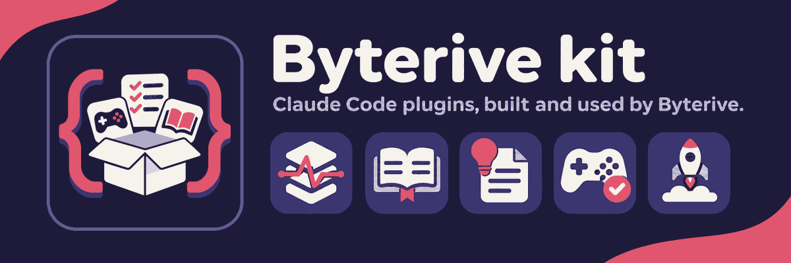

# Byterive kit

Five Claude Code plugins, one marketplace.

MIT · Works with Claude Code

## What it is

We built these plugins for our own projects and share them as a marketplace called `byterive-kit`. Each plugin is its own repository; this repository lists them and holds the how-to for each.

## Install


```
/plugin marketplace add Byterive/kit
/plugin install kickoff@byterive-kit
/plugin install guidebook@byterive-kit
/plugin install unity-game-kit@byterive-kit
/plugin install idea2spec@byterive-kit
/plugin install cachepulse@byterive-kit
```

After a new version is released: `/plugin marketplace update byterive-kit`. More in [install and update](docs/howto/00-install-and-update.md).

## What you get

| plugin | what it does | how-to |
|---|---|---|
| [kickoff](https://github.com/Byterive/kickoff) | Starts a project in one command (a short brief interview, a per-project plugin set, status and decision files, a health check, safety hooks) and picks it up again next session | [01](docs/howto/01-kickoff.md) |
| [guidebook](https://github.com/Byterive/guidebook) | Turns a project into plain-language HTML guides for different readers and refreshes them when the project changes | [13](docs/howto/13-guidebook.md) |
| [unity-game-kit](https://github.com/Byterive/unity-game-kit) | Sets up a Unity game for Claude Code: Android build and install, Editor checks, local ComfyUI art, 2D game skills, and a doctor that says what is missing | [02](docs/howto/02-unity-game-kit.md) |
| [idea2spec](https://github.com/Byterive/idea2spec) | Tests an idea before you build it: a short interview, web research on the nearest alternatives, a score, and a GO, CLARIFY or KILL verdict. It writes a spec only on GO | [12](docs/howto/12-idea2spec.md) |
| [cachepulse](https://github.com/Byterive/cachepulse) | Shows whether Claude Code reused its prompt cache, how long the cache may last, and the likely cause of a miss with its evidence | [14](docs/howto/14-cachepulse.md) |

To add or change a skill, command, agent, hook or plugin in a kit like this one, see [07](docs/howto/07-add-or-change-a-skill.md).

## Needs and limits

- Claude Code, and Python 3 for the plugins' scripts.
- unity-game-kit targets Windows, Unity 6 and Android.
- Some kickoff profiles suggest optional third-party companion plugins (for example Unity's own skills or frontend-design). They are not part of kickoff, we do not endorse them, and nothing installs without your yes.
- guidebook is early (version 0.2.1).
- idea2spec is early (version 0.1.1). Its research agents search and fetch public web pages.
- cachepulse is early (version 0.1.53) and uses Claude Code's early-access plugin API, which can change between releases.

## Check the kit

```
python tools/kit.py status      (for maintainers) every plugin repo: branch, uncommitted files, remote
python tools/kit.py validate    every plugin and this marketplace
```

`marketplace.json` is generated from `kit.json` (`python tools/kit.py sources github`); do not edit it by hand.

## Credits and license

License: MIT. Copyright (c) 2026 Junaid Iqbal (Byterive).

Unity, ComfyUI and Android are trademarks of their owners; this project is not affiliated with them.

*Independent project by Byterive. Not affiliated with or endorsed by Anthropic.* · [byterive.com](https://byterive.com)
